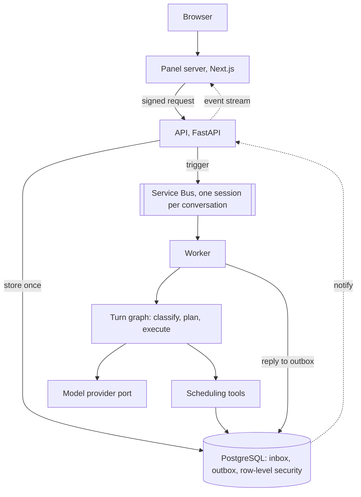

# Frontdesk

A small business answers the same questions and books the same slots all day on WhatsApp. This system answers and books for it, inside limits the business sets, and hands the conversation to a person when it should not decide alone. It is multi-tenant and built to run on Azure.

This is a portfolio project. The two businesses in it are fictional. I am building it in phases, and this file says what exists today, not what is planned. The plan is in [docs/spec.md](docs/spec.md).

## Status

Phase 1 of 6 is done: a vertical slice that runs on one machine.

What works now. A customer writes in a web chat. The message is authenticated, stored once and put on a queue. A worker runs one turn of an explicit agent graph that can list services, quote prices by time of day, check availability, book, reschedule and cancel. The reply goes to an outbox and reaches the browser through an event stream. Two tenants with different services, prices and hours live in one PostgreSQL, isolated by row-level security.

What does not exist yet. WhatsApp itself, the numeric guardrail, owner rules and approval, the eval suite, retrieval, cost routing, the owner's panel, and the Azure deployment. Locally the agent runs on a deterministic offline model that understands a handful of phrasings by keyword. It is there so the pipeline can run and be measured with no cloud account. Nothing about answer quality should be read from it. The adapter for a real model, Azure OpenAI, is written and tested against canned responses; it has not answered a real conversation yet, and the evaluation that would say how well it does is Phase 3.

## Run it

```
docker compose up --build
```

Then open http://localhost:3700 and talk to one of the two businesses. Docker is the only requirement. The first run downloads about 3 GB of images, most of it the SQL Server that Microsoft's Service Bus emulator needs, and the stack uses about 1.7 GB of memory.

To talk to a real model instead of the offline one, put the endpoint and key of an Azure OpenAI deployment in `.env`, as `.env.example` shows, and start it again.

## Architecture



The decisions behind this, each with the alternatives I rejected and what the choice costs, are in [docs/adr](docs/adr). Three I would read first:

- [0001](docs/adr/0001-postgres-inbox-and-session-queue-as-trigger.md): PostgreSQL is the inbox and the queue only carries a trigger, because a lock on a queue is not exclusivity. It also says what a session per conversation costs in latency.
- [0004](docs/adr/0004-row-level-security-with-transaction-scoped-tenant.md): tenant isolation by row-level security with a setting that lives for one transaction.
- [0006](docs/adr/0006-deterministic-numeric-guardrail.md): the numeric guardrail as deterministic code, planned for Phase 2.

Facts about third-party services that the design depends on were checked against their documentation and recorded with links and dates in [docs/verificado.md](docs/verificado.md), including what the documentation did not settle.

## Measured

Every number here comes from [docs/medicoes.md](docs/medicoes.md), which has the environment and the command that reproduces it.

Latency of the pipeline without a model, from message sent to reply on the stream, on one laptop against the Service Bus emulator: median 144 ms and p95 549 ms with one conversation at a time; median 1.77 s and p95 2.12 s with ten at a time, at 5.7 messages per second. This is the overhead around the model, and most of it is the queue: a session per conversation costs a connection handshake on every turn. The measurement entry explains it and ADR 0001 names the faster alternative I did not take. Latency with a real model has not been measured yet.

## Tests

```
make check
```

The backend tests run against a real PostgreSQL in a container. The queue has one contract suite that runs against Azure Service Bus in Microsoft's emulator and against the in-memory queue the other tests use, so the stand-in cannot drift from the real thing. The other test doubles are at the external edges: the model provider and the channel. Tests cite the requirement they prove by its id in the specification, for example `TEN-2` for tenant isolation and `BOOK-3` for the constraint against double booking.

## What I chose not to build and why

A permanent public demo. The always-on environment is estimated at USD 85 per month and the project runs on a student subscription with USD 100 of credit. The deployment will be applied for a measured window and destroyed, and a short video will stand in for the link. The estimate is in [docs/design/cost-estimate.md](docs/design/cost-estimate.md).

A generic ReAct agent from a library. The turn is an explicit graph, so every step is a place where a limit can be enforced and a number can be measured.

LangChain model wrappers. The model is called through the vendor SDK behind one small port. The reasons are in [ADR 0003](docs/adr/0003-provider-port-over-vendor-sdks.md).

A second cloud or a second model vendor. Everything runs on Azure, and the model comparison planned for Phase 3 is across the models one student subscription can deploy. [ADR 0008](docs/adr/0008-one-cloud-azure.md) says why, including the part that was decided by the account and not by me.

A private network. The demo reaches the database and the queue over public endpoints guarded by identity and a firewall, which is cheaper and weaker than a virtual network. [ADR 0010](docs/adr/0010-public-endpoints-behind-identity-and-a-firewall.md).

Token streaming to the customer. A reply is checked before it is sent, so nothing is shown that might be retracted.

Payments, plan billing, a mobile app, Kubernetes, fine-tuning, multi-region, self-service signup and outbound campaigns are out of scope.
