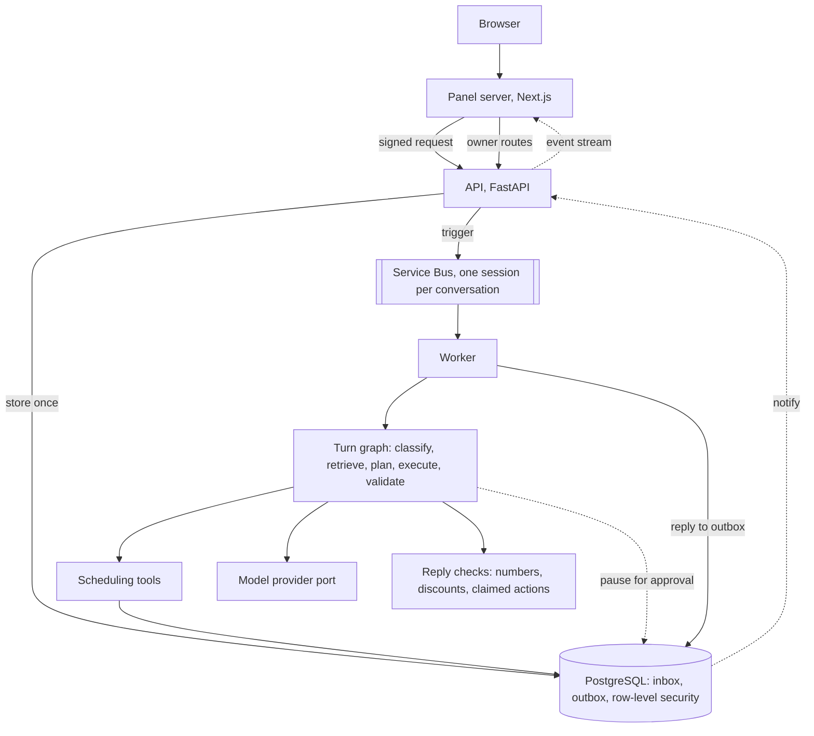

# Frontdesk

A small business answers the same questions and books the same slots all day on WhatsApp. This system answers and books for it, inside limits the business sets, and hands the conversation to a person when it should not decide alone. It is multi-tenant and built to run on Azure.

This is a portfolio project, built in six phases, and the two businesses in it are fictional. This file says what exists and what was measured, not what is planned. The plan it was built against is in [docs/spec.md](docs/spec.md).

## If you have five minutes

- [docs/medicoes.md](docs/medicoes.md) is the log of every number in this file, with the command that reproduces it. It also has the times a measurement proved me wrong: a hypothesis about throttling that the load refuted, a defect a repeated run exposed, and what the first deployment and the first real conversation found that no test had.
- [The numeric guardrail](backend/src/frontdesk/guardrail) is deterministic code that lets a price, a time or a date into a reply only if a tool of that turn returned it. [ADR 0006](docs/adr/0006-deterministic-numeric-guardrail.md) has what it blocked and what it missed when measured.
- [The isolation test](backend/tests/test_tenant_isolation.py) connects as the application's role and tries to read and write another tenant's rows. [ADR 0004](docs/adr/0004-row-level-security-with-transaction-scoped-tenant.md) is the design it proves.
- Two open pull requests show the evaluation gate at work: [one](https://github.com/dev-isaacmello/frontdesk/pull/1) it lets through with the numbers, [the other](https://github.com/dev-isaacmello/frontdesk/pull/2) it stops, naming the four conversations the change broke. They are there to be read and not to be merged.
- [ADR 0001](docs/adr/0001-postgres-inbox-and-session-queue-as-trigger.md) is the decision the rest stands on: PostgreSQL is the inbox, the queue carries only a trigger, and a lock on a queue is not exclusivity.

## Status

All six phases have run. The last to close is the deployment: the environment was applied on Azure on 2026-11-18, answered real messages on WhatsApp and was destroyed the same day. What that window cost against the estimate is the one number still missing, because Azure had not billed it when this was written.

What works. A customer writes on WhatsApp or in a web chat. The message is authenticated, stored once and put on a queue. A worker runs one turn of an explicit agent graph that can list services, quote prices by time of day, check availability, book, reschedule and cancel. Before a reply is sent, code checks it: it has to be a text at all; every amount, time, date, duration and count has to come from a tool of that turn, the opening hours or the customer's own words; no discount is offered; no booking is announced that a tool did not make. A draft that fails goes back to the planner once, and a second failure hands the conversation to a person. Cancelling or moving a booking on short notice waits for the owner: the turn pauses, the customer is told, and the decision resumes it, in whichever worker receives it. The owner has a panel with the conversations, how each reply was made step by step, the approval queue, an editor for house rules that says which rules contradict the fixed policy, what the agent did and cost day by day, and the comparison of models. Two tenants with different services, prices and hours live in one PostgreSQL, isolated by row-level security.

Knowledge and cost. What a business knows and its catalog does not, such as the address or how late a customer may arrive, is kept as short texts and retrieved into the turn by an exact vector search that row-level security confines to the tenant. Each business has a monthly budget for model calls: at the budget it is served by a cheaper model, past it by a person. The whole deployment has a daily cap, and a switch an operator can flip to stop every model call.

The evaluation. A golden set of 41 conversations in pt-BR runs through the real worker against a real model and is judged by code. A pull request that touches prompts, graph, tools, providers or checks runs it in CI, signed in to Azure with a federated identity and no stored key, and fails when two cases that pass in every run on main no longer do.

Operation. Every message produces one OpenTelemetry trace from the request to the reply, across the queue, and the API and the worker push metrics: how long each node took, tokens and cost per tenant, tool errors, blocked drafts, handoffs, how long a message waited for its turn, failed deliveries and dead letters. Neither carries what a customer wrote or is called. Two optional containers show them locally, `docker compose --profile traces` for Phoenix and `--profile metrics` for Prometheus. A script puts the stack under load and another breaks it on purpose and checks what the customers got; [docs/runbooks](docs/runbooks) says what to look at and do in four failures, two of them rehearsed that way.

On Azure. The Terraform in [infra](infra) was applied on a student subscription, and the deploy workflow builds, migrates and rolls the system with a federated identity. It answered there through the real Service Bus, with the worker calling the model as a managed identity and no key. The first apply found five things no local run could: a refused availability zone, an environment created in a tier that has no jobs, 181 shared outbound addresses where the design expected one or two, a schema the database's owner does not own, and a role that does not reach jobs.

On WhatsApp. A message sent from a phone to Meta's test number reached the deployment, was answered by the agent and arrived back on the phone. Between the first message and that reply stood an account that was not subscribed to the app, a secret the platform had not refreshed, a Brazilian number that arrives without its ninth digit, and a classifier that the model answered with nothing whenever the conversation had a history. A few messages later the same conversation showed two replies that were not replies, one garbled and one empty, which every check had passed. Each of these is fixed, has a test where a test can hold it, and is in the measurement log in the order it was found.

What does not exist. A screen to edit the knowledge base, which comes from the seed. A dashboard or an alarm over the metrics, apart from one alert on dead letters in the Terraform. A long-lived WhatsApp token: with Meta's temporary one the channel answers for about ninety minutes at a time. A worker that paces its own model calls to the provider's quota, where today it finds the limit by hitting it. Without a model key the agent runs on a deterministic offline model that understands a handful of phrasings by keyword. It is there so the pipeline can run and be measured with no cloud account, and nothing about answer quality should be read from it.

## Run it

```
docker compose up --build
```

Then open http://localhost:3700 and talk to one of the two businesses. Docker is the only requirement. The first run downloads about 3 GB of images, most of it the SQL Server that Microsoft's Service Bus emulator needs, and the stack uses about 1.7 GB of memory.

To talk to a real model instead of the offline one, put the endpoint and key of an Azure OpenAI deployment in `.env`, as `.env.example` shows, and start it again.

The owner's panel is at http://localhost:3700/painel. The two demo owners are `dono@navalha.example` and `dono@ponto-final.example`, and their password is the value of `FRONTDESK_DEMO_OWNER_PASSWORD`, whose local default is in `compose.yaml`. An approval only appears when a customer asks to cancel or move a booking of the barbershop that starts within three hours.

## Architecture



The fifteen decisions behind this, each with the alternatives I rejected and what the choice costs, are in [docs/adr](docs/adr). Several end with a section on what building or deploying it showed, where that differed from the decision. What to look at and what to do when the queue grows, the model provider is down, the webhook signature fails or cost passes its budget is in [docs/runbooks](docs/runbooks).

Facts about third-party services that the design depends on were checked against their documentation and recorded with links and dates in [docs/verificado.md](docs/verificado.md), including what the documentation did not settle.

## Measured

Every number here comes from [docs/medicoes.md](docs/medicoes.md), which has the environment and the command that reproduces it.

Latency of the pipeline without a model, from message sent to reply on the stream, on one laptop against the Service Bus emulator: median 144 ms and p95 549 ms with one conversation at a time; median 1.77 s and p95 2.12 s with ten at a time, at 5.7 messages per second. This is the overhead around the model, and most of it is the queue: a session per conversation costs a connection handshake on every turn. The measurement entry explains it and ADR 0001 names the faster alternative I did not take. With `gpt-5-mini` on Azure OpenAI answering, the same path takes a median of 8.1 s and a p95 of 10.4 s for a price question, of which 6.4 s are three or four sequential model calls and 1.5 s is the wait for the customer to finish typing. One such turn costs a tenth of a cent.

The golden set, three runs per model: `gpt-oss-120b` passes 35, 36 and 35 of 37 conversations at USD 0.0006 per conversation and 2.6 s of model time per turn; `gpt-5-mini` 34, 34 and 37 at USD 0.0011 and 8.3 s; `gpt-4.1-mini` 34, 33 and 35 at USD 0.0006 and 3.3 s. One change of prompt had taken `gpt-5-mini` from 28, 29 and 27 of 32 to 31, 32 and 30. Three more models were deployed and cannot call tools the way the agent needs. Those runs are of the set when it had 37 conversations. With the 41 of today, after the classifier's input changed, `gpt-oss-120b` passes 38, 38, 40 and 40 across four runs, and 36 conversations pass in every one, which is what the gate compares a pull request against.

Retrieval, on 30 labelled questions: the entry that answers is among the three retrieved for 24 of 24, and first for 22. On the golden set it turns five conversations that could not be answered into five that are, with no loss I could measure on the other 32.

Routing: sending only the classifier to the cheaper model takes 13% off the cost of a conversation on `gpt-5-mini`, with as many conversations passed. Sending every call to `gpt-oss-120b` halves it, which is why that is the default and the router is used for plans and spent budgets instead.

Under load, on the same laptop and emulator: with the offline model one worker of six slots answers 5.7 conversations per second however many customers wait, with a p95 of 2.7 s at twelve customers at once and 4.2 s at twenty-four, and nobody unanswered. With `gpt-oss-120b` the limit is the deployment's 100 requests per minute: three customers at once are all answered with a median of 4.8 s and a p95 of 7.1 s, and at six the provider throttles and everyone is still answered, late, with a p95 of 28 s. The first run of this had 4 of 21 customers handed to a person at six; the cause was a throttled call failing its whole turn, which I had first misread, and the two entries have the wrong fix, the right one and what is still wasteful.

Failures made on purpose. A worker killed before its turns started: twelve of twelve customers answered once, the last 4.2 s after the restart. A worker killed in the middle of six turns: six of six answered once, the last 43 s after the restart. It was 173 s until a running turn started renewing a short reservation of its conversation instead of holding a long one. The model unreachable: six of six told after 37 s that a person takes over, and service back for the next customer when the model is.

On WhatsApp, against Meta: a signed notification accepted, a turn, a send accepted, and the three delivery notifications that follow, on the third message of the first conversation. The first two stopped on an expired token the worker still held and on a number without its ninth digit.

On Azure, the same load from a laptop in another continent: three customers at once answered with a median of 4.5 s and a p95 of 9.8 s, the numbers of the local stack on the same model. The real queue across a network added no delay I can see at that load.

The reply checks, on a labelled set of 95 replies: 44 of 50 adversarial replies blocked (88.0%) and 3 of 45 benign replies blocked (6.7%). Half of the misses are a right value next to the wrong thing, which the check cannot see by design; the other half are a weakness of mine that the entry describes.

## Tests

```
make check
```

The backend has about 640 tests and they run against a real PostgreSQL in a container, including the checkpointer that keeps a turn paused for approval. The queue has one contract suite that runs against Azure Service Bus in Microsoft's emulator and against the in-memory queue the other tests use, so the stand-in cannot drift from the real thing. The other test doubles are at the external edges: the model provider and the channel. Tests cite the requirement they prove by its id in the specification, for example `TEN-2` for tenant isolation and `BOOK-3` for the constraint against double booking.

## What I chose not to build and why

A permanent public demo. The always-on environment is estimated at USD 85 per month and the project runs on a student subscription with USD 100 of credit. The deployment was applied for a window of five and a half hours and destroyed, and a short video is to stand in for the link; it is not recorded yet. The estimate is in [docs/design/cost-estimate.md](docs/design/cost-estimate.md).

A model that judges the model. Every expectation of the golden set is checked by code, against the reply as the guardrail's extractor reads it and against the database. It keeps the evaluation cheap and repeatable, and it means the set only asks what code can verify.

A generic ReAct agent from a library. The turn is an explicit graph, so every step is a place where a limit can be enforced and a number can be measured.

LangChain model wrappers. The model is called through the vendor SDK behind one small port. The reasons are in [ADR 0003](docs/adr/0003-provider-port-over-vendor-sdks.md).

A second cloud or a second model vendor. Everything runs on Azure, and the model comparison is across the models one student subscription can deploy. [ADR 0008](docs/adr/0008-one-cloud-azure.md) says why, including the part that was decided by the account and not by me.

A private network. The demo reaches the database and the queue over public endpoints guarded by identity and a firewall, which is cheaper and weaker than a virtual network. [ADR 0010](docs/adr/0010-public-endpoints-behind-identity-and-a-firewall.md).

An approximate vector index. With a few dozen texts per business an exact scan is fast, and it is the only search whose result cannot depend on another tenant's rows. [ADR 0012](docs/adr/0012-exact-vector-search-under-row-level-security.md) names the point where that stops being true.

Token streaming to the customer. A reply is checked before it is sent, so nothing is shown that might be retracted.

Payments, plan billing, a mobile app, Kubernetes, fine-tuning, multi-region, self-service signup and outbound campaigns are out of scope.
