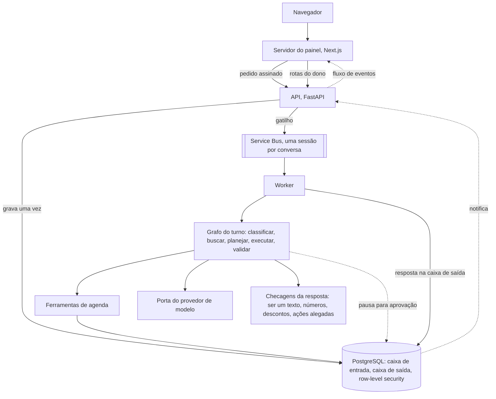

# Frontdesk

[English](README.md) | Português

Um pequeno negócio responde as mesmas perguntas e marca os mesmos horários o dia inteiro pelo WhatsApp. Este sistema responde e agenda por ele, dentro dos limites que o negócio define, e passa a conversa para uma pessoa quando não deve decidir sozinho. É multi-tenant e foi construído para rodar na Azure.

Este é um projeto de portfólio, construído em seis fases, e os dois negócios que aparecem nele são fictícios. Este arquivo diz o que existe e o que foi medido, não o que está planejado. O plano contra o qual ele foi construído está em [docs/spec.md](docs/spec.md). O código, os commits e a documentação técnica estão em inglês; os prompts, os casos de avaliação e os dados de exemplo estão em português, porque os clientes estão.

## Se você tem cinco minutos

- [docs/medicoes.md](docs/medicoes.md) é o registro de todo número deste arquivo, com o comando que o reproduz. Ele também tem as vezes em que uma medição mostrou que eu estava errado: uma hipótese sobre throttling que a carga refutou, um defeito que só apareceu repetindo a execução, e o que o primeiro deploy e a primeira conversa real encontraram que nenhum teste tinha encontrado.
- [O guardrail numérico](backend/src/frontdesk/guardrail) é código determinístico que só deixa um preço, um horário ou uma data entrar numa resposta se uma ferramenta daquele turno devolveu esse valor. O [ADR 0006](docs/adr/0006-deterministic-numeric-guardrail.md) tem o que ele barrou e o que deixou passar quando foi medido.
- [O teste de isolamento](backend/tests/test_tenant_isolation.py) conecta com o papel da aplicação e tenta ler e escrever linhas de outro tenant. O [ADR 0004](docs/adr/0004-row-level-security-with-transaction-scoped-tenant.md) é o desenho que ele prova.
- Dois pull requests mostram o gate de avaliação funcionando: [um](https://github.com/dev-isaacmello/frontdesk/pull/1) ele deixa passar, com os números, e [o outro](https://github.com/dev-isaacmello/frontdesk/pull/2) ele barra, apontando as conversas que a mudança quebrou, quatro numa execução e três das mesmas quatro na seguinte. Foram abertos para serem lidos e estão fechados sem merge, cada um com o motivo.
- O [ADR 0001](docs/adr/0001-postgres-inbox-and-session-queue-as-trigger.md) é a decisão em que o resto se apoia: o PostgreSQL é a caixa de entrada, a fila carrega só um gatilho, e um lock numa fila não é exclusividade.

## Estado

As seis fases rodaram. A última a fechar é o deploy: o ambiente foi aplicado na Azure em 18/11/2026, respondeu mensagens reais no WhatsApp e foi destruído no mesmo dia. Quanto essa janela custou em relação à estimativa é o único número que ainda falta, porque a Azure não tinha faturado quando isto foi escrito.

O que funciona. Um cliente escreve pelo WhatsApp ou por um chat na web. A mensagem é autenticada, gravada uma única vez e colocada numa fila. Um worker roda um turno de um grafo explícito, que sabe listar serviços, cotar preços por horário, ver disponibilidade, agendar, remarcar e cancelar. Antes de uma resposta ser enviada, código a confere: ela precisa ser um texto; todo valor, horário, data, duração e quantidade tem de ter vindo de uma ferramenta daquele turno, do horário de funcionamento ou das palavras do próprio cliente; nenhum desconto é oferecido; nenhum agendamento é anunciado sem que uma ferramenta o tenha feito. Um rascunho que falha volta ao planejador uma vez, e a segunda falha entrega a conversa a uma pessoa. Cancelar ou mudar um agendamento em cima da hora espera pelo dono: o turno pausa, o cliente é avisado, e a decisão retoma o turno, no worker que a receber. O dono tem um painel com as conversas, como cada resposta foi feita passo a passo, a fila de aprovações, um editor de regras da casa que aponta quais regras contradizem a política fixa, o que o agente fez e custou dia a dia, e a comparação de modelos. Dois tenants com serviços, preços e horários diferentes vivem no mesmo PostgreSQL, isolados por row-level security.

Conhecimento e custo. O que um negócio sabe e o catálogo não diz, como o endereço ou a tolerância de atraso, fica em textos curtos e entra no turno por uma busca vetorial exata, que o row-level security restringe ao tenant. Cada negócio tem um orçamento mensal de chamadas de modelo: ao atingi-lo, passa a ser atendido por um modelo mais barato, e além dele, por uma pessoa. O deploy inteiro tem um teto diário e uma chave que um operador pode virar para parar toda chamada de modelo.

A avaliação. Um golden set de 41 conversas em pt-BR roda pelo worker real contra um modelo real e é julgado por código. Um pull request que mexe em prompts, grafo, ferramentas, provedores ou checagens roda esse conjunto no CI, autenticado na Azure por identidade federada e sem chave guardada, e falha quando dois casos que passam em toda execução no main deixam de passar.

Operação. Cada mensagem gera um trace OpenTelemetry do pedido até a resposta, atravessando a fila, e a API e o worker enviam métricas: quanto cada nó levou, tokens e custo por tenant, erros de ferramenta, rascunhos barrados, handoffs, quanto uma mensagem esperou pelo turno, entregas que falharam e dead letters. Nenhum dos dois carrega o que um cliente escreveu nem o nome dele. Dois contêineres opcionais mostram isso localmente, `docker compose --profile traces` para o Phoenix e `--profile metrics` para o Prometheus. Um script põe a pilha sob carga e outro a quebra de propósito e confere o que os clientes receberam; [docs/runbooks](docs/runbooks) diz o que olhar e o que fazer em quatro falhas, duas delas ensaiadas assim.

Na Azure. O Terraform em [infra](infra) foi aplicado numa assinatura de estudante, e o workflow de deploy constrói, migra e troca a versão do sistema com identidade federada. Ele respondeu lá pelo Service Bus de verdade, com o worker chamando o modelo como identidade gerenciada, sem chave. O primeiro apply encontrou cinco coisas que nenhuma execução local tinha como mostrar: uma zona de disponibilidade recusada, um ambiente criado num nível que não tem jobs, 181 endereços de saída compartilhados onde o desenho esperava um ou dois, um schema que não pertence ao dono do banco, e um papel que não alcança jobs.

No WhatsApp. Uma mensagem enviada de um celular para o número de teste da Meta chegou ao deploy, foi respondida pelo agente e voltou ao celular. Entre a primeira mensagem e essa resposta havia uma conta que não estava inscrita no app, um segredo que a plataforma não tinha atualizado, um número brasileiro que chega sem o nono dígito, e um classificador a que o modelo respondia com nada sempre que a conversa tinha histórico. Algumas mensagens depois, a mesma conversa mostrou duas respostas que não eram respostas, uma sem sentido e uma vazia, que todas as checagens tinham deixado passar. Cada uma dessas coisas está corrigida, tem teste onde um teste consegue segurá-la, e está no registro de medições na ordem em que apareceu.

O que não existe. Uma tela para editar a base de conhecimento, que vem do seed. Um dashboard ou um alarme sobre as métricas, fora um alerta de dead letters no Terraform. Um token de WhatsApp de longa duração: com o temporário da Meta, o canal responde por cerca de noventa minutos de cada vez. Um worker que dose as próprias chamadas de modelo pela cota do provedor; hoje ele descobre o limite batendo nele. Sem chave de modelo, o agente roda num modelo offline determinístico, que entende um punhado de frases por palavra-chave. Ele existe para que o pipeline rode e seja medido sem conta em nuvem, e não se deve tirar dele nenhuma conclusão sobre qualidade de resposta.

## Como rodar

```
docker compose up --build
```

Depois abra http://localhost:3700 e converse com um dos dois negócios. O único requisito é o Docker. A primeira execução baixa cerca de 3 GB de imagens, a maior parte do SQL Server de que o emulador do Service Bus da Microsoft precisa, e a pilha usa cerca de 1,7 GB de memória.

Para conversar com um modelo real em vez do offline, coloque o endpoint e a chave de um deployment do Azure OpenAI no `.env`, como o `.env.example` mostra, e suba de novo.

O painel do dono fica em http://localhost:3700/painel. Os dois donos de demonstração são `dono@navalha.example` e `dono@ponto-final.example`, e a senha é o valor de `FRONTDESK_DEMO_OWNER_PASSWORD`, cujo padrão local está no `compose.yaml`. Uma aprovação só aparece quando um cliente pede para cancelar ou mudar um agendamento da barbearia que começa em menos de três horas.

## Arquitetura



As quinze decisões por trás disso, cada uma com as alternativas que rejeitei e o que a escolha custa, estão em [docs/adr](docs/adr). Várias terminam com uma seção sobre o que construir ou implantar mostrou, quando isso diferiu da decisão. O que olhar e o que fazer quando a fila cresce, o provedor de modelo cai, a assinatura do webhook falha ou o custo passa do orçamento está em [docs/runbooks](docs/runbooks).

Os fatos sobre serviços de terceiros dos quais o desenho depende foram conferidos na documentação de cada um e registrados com link e data em [docs/verificado.md](docs/verificado.md), incluindo o que a documentação não resolveu.

## Medido

Todo número aqui vem de [docs/medicoes.md](docs/medicoes.md), que tem o ambiente e o comando que o reproduz.

Latência do pipeline sem modelo, da mensagem enviada à resposta no fluxo, num laptop contra o emulador do Service Bus: mediana de 144 ms e p95 de 549 ms com uma conversa por vez; mediana de 1,77 s e p95 de 2,12 s com dez ao mesmo tempo, a 5,7 mensagens por segundo. Esse é o custo de tudo em volta do modelo, e a maior parte é a fila: uma sessão por conversa custa um handshake de conexão em cada turno. A entrada de medição explica, e o ADR 0001 nomeia a alternativa mais rápida que eu não escolhi. Com o `gpt-5-mini` no Azure OpenAI respondendo, o mesmo caminho leva uma mediana de 8,1 s e um p95 de 10,4 s para uma pergunta de preço, dos quais 6,4 s são três ou quatro chamadas de modelo em sequência e 1,5 s é a espera para o cliente terminar de digitar. Um turno desses custa um décimo de centavo de dólar.

O golden set, três execuções por modelo: o `gpt-oss-120b` passa em 35, 36 e 35 de 37 conversas, a US$ 0,0006 por conversa e 2,6 s de modelo por turno; o `gpt-5-mini`, em 34, 34 e 37, a US$ 0,0011 e 8,3 s; o `gpt-4.1-mini`, em 34, 33 e 35, a US$ 0,0006 e 3,3 s. Uma mudança de prompt tinha levado o `gpt-5-mini` de 28, 29 e 27 de 32 para 31, 32 e 30. Outros três modelos foram implantados e não conseguem chamar ferramentas do jeito que o agente precisa. Essas execuções são do conjunto quando ele tinha 37 conversas. Com as 41 de hoje, depois que a entrada do classificador mudou, o `gpt-oss-120b` passa em 38, 38, 40 e 40 em quatro execuções, e 36 conversas passam em todas, que é contra o que o gate compara um pull request.

Recuperação, em 30 perguntas rotuladas: o texto que responde está entre os três recuperados em 24 de 24, e em primeiro em 22. No golden set, ela transforma cinco conversas que não podiam ser respondidas em cinco que são, sem perda que eu tenha conseguido medir nas outras 32.

Roteamento: mandar só o classificador para o modelo mais barato tira 13% do custo de uma conversa no `gpt-5-mini`, com o mesmo número de conversas aprovadas. Mandar toda chamada para o `gpt-oss-120b` corta o custo pela metade, e por isso ele é o padrão e o roteador fica para planos e orçamentos estourados.

Sob carga, no mesmo laptop e emulador: com o modelo offline, um worker de seis slots responde 5,7 conversas por segundo por mais clientes que esperem, com p95 de 2,7 s com doze clientes ao mesmo tempo e de 4,2 s com vinte e quatro, e ninguém sem resposta. Com o `gpt-oss-120b`, o limite é a cota de 100 requisições por minuto do deployment: três clientes ao mesmo tempo são todos respondidos, com mediana de 4,8 s e p95 de 7,1 s, e com seis o provedor estrangula e todos ainda são respondidos, com atraso, com p95 de 28 s. A primeira execução disso teve 4 de 21 clientes entregues a uma pessoa com seis clientes; a causa era uma chamada estrangulada derrubar o turno inteiro, o que eu li errado na primeira vez, e as duas entradas têm a correção errada, a certa e o que ainda é desperdício.

Falhas provocadas de propósito. Um worker morto antes de os turnos começarem: doze de doze clientes respondidos uma vez, o último 4,2 s depois de o worker voltar. Um worker morto no meio de seis turnos: seis de seis respondidos uma vez, o último 43 s depois de o worker voltar. Eram 173 s, até que um turno em andamento passou a renovar uma reserva curta da conversa em vez de segurar uma longa. O modelo inalcançável: seis de seis avisados depois de 37 s de que uma pessoa assume, e o serviço de volta para o cliente seguinte quando o modelo volta.

No WhatsApp, contra a Meta: uma notificação assinada aceita, um turno, um envio aceito e as três notificações de entrega que vêm em seguida, na terceira mensagem da primeira conversa. As duas primeiras pararam num token expirado que o worker ainda guardava e num número sem o nono dígito.

Na Azure, a mesma carga a partir de um laptop em outro continente: três clientes ao mesmo tempo respondidos com mediana de 4,5 s e p95 de 9,8 s, os números da pilha local com o mesmo modelo. A fila de verdade, através de uma rede, não acrescentou atraso que eu consiga ver nessa carga.

As checagens da resposta, num conjunto rotulado de 95 respostas: 44 de 50 respostas adversariais barradas (88,0%) e 3 de 45 respostas legítimas barradas (6,7%). Metade das que passam é um valor certo ao lado da coisa errada, que a checagem não vê por desenho; a outra metade é uma fraqueza minha que a entrada descreve.

## Testes

```
make check
```

O backend tem cerca de 640 testes, que rodam contra um PostgreSQL de verdade num contêiner, incluindo o checkpointer que mantém um turno pausado à espera de aprovação. A fila tem uma suíte de contrato que roda contra o Azure Service Bus no emulador da Microsoft e contra a fila em memória que os outros testes usam, para que o substituto não se afaste do real. Os outros dublês ficam nas bordas externas: o provedor de modelo e o canal. Os testes citam o requisito que provam pelo id na especificação, por exemplo `TEN-2` para isolamento entre tenants e `BOOK-3` para a restrição contra agendamento duplo.

## O que escolhi não construir e por quê

Uma demo pública permanente. O ambiente sempre ligado é estimado em US$ 85 por mês, e o projeto roda numa assinatura de estudante com US$ 100 de crédito. O deploy foi aplicado por uma janela de cinco horas e meia e destruído, e um vídeo curto vai ficar no lugar do link; ele ainda não foi gravado. A estimativa está em [docs/design/cost-estimate.md](docs/design/cost-estimate.md).

Um modelo que julga o modelo. Toda expectativa do golden set é conferida por código, contra a resposta como o extrator do guardrail a lê e contra o banco. Isso mantém a avaliação barata e repetível, e significa que o conjunto só pergunta o que código consegue verificar.

Um agente ReAct genérico de biblioteca. O turno é um grafo explícito, então cada passo é um lugar onde um limite pode ser imposto e um número pode ser medido.

Wrappers de modelo do LangChain. O modelo é chamado pelo SDK do fornecedor, atrás de uma porta pequena. Os motivos estão no [ADR 0003](docs/adr/0003-provider-port-over-vendor-sdks.md).

Uma segunda nuvem ou um segundo fornecedor de modelo. Tudo roda na Azure, e a comparação de modelos é entre os que uma assinatura de estudante consegue implantar. O [ADR 0008](docs/adr/0008-one-cloud-azure.md) diz por quê, incluindo a parte que foi decidida pela conta e não por mim.

Uma rede privada. A demo alcança o banco e a fila por endpoints públicos protegidos por identidade e firewall, o que é mais barato e mais fraco do que uma rede virtual. [ADR 0010](docs/adr/0010-public-endpoints-behind-identity-and-a-firewall.md).

Um índice vetorial aproximado. Com algumas dezenas de textos por negócio uma varredura exata é rápida, e é a única busca cujo resultado não pode depender das linhas de outro tenant. O [ADR 0012](docs/adr/0012-exact-vector-search-under-row-level-security.md) nomeia o ponto em que isso deixa de ser verdade.

Streaming de tokens para o cliente. Uma resposta é conferida antes de ser enviada, então nada é mostrado que possa ter de ser retirado.

Pagamentos, cobrança por plano, aplicativo móvel, Kubernetes, fine-tuning, multi-região, cadastro self-service e campanhas de envio estão fora do escopo.
