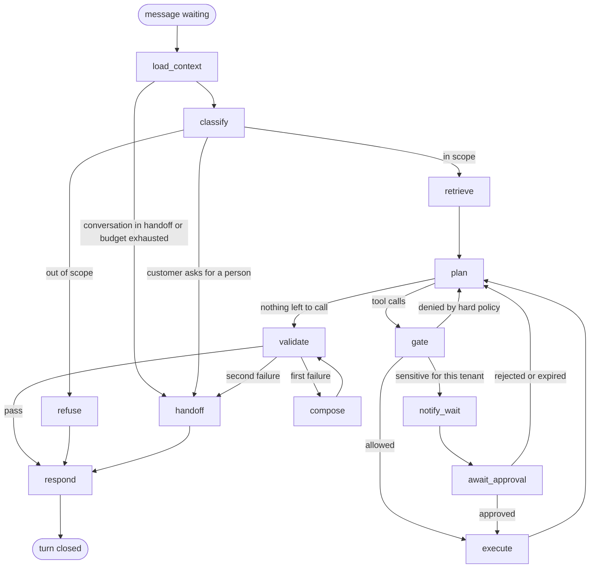

# Agent graph

Status: proposed in Phase 0 and built through Phase 4. The section "What was built differently" at the end lists where the code departs from this text.

The agent is an explicit LangGraph graph. LangGraph gives me three things I would otherwise write by hand: a typed state passed between nodes, a durable checkpoint after each step, and interrupt and resume for the owner's approval. The model calls inside the nodes go through my own provider port, not through a prebuilt agent.

## Unit of work

A turn is one run of the graph over the customer messages that arrived since the last turn. Each turn runs on its own graph thread, with the thread id derived from the turn id. Conversation history is domain data in Postgres and is loaded into the state at the start of the turn; it is not accumulated in the checkpoint. The reason is the approval flow: a turn that is waiting for the owner can stay interrupted for hours while the customer keeps talking, and those new messages need to run as new turns without touching the interrupted one. ADR 0002 has the alternatives.

## Nodes

What each node does, and whether a model is involved:

- `load_context` (code). Reads tenant profile and policy, the active version of the house rules, the recent message window, pending approvals of this conversation and the budget level. Everything later in the turn uses this snapshot.
- `classify` (small model, structured output). Intent, whether the message is inside the tenant's business, and a flag for instruction-like content in the customer text. A few cases are decided before the model by plain matching, for example an explicit request to talk to a person.
- `refuse` (code). Out-of-scope messages get a fixed, tenant-branded reply. No large model is spent on them.
- `retrieve` (embedding call plus SQL). Top-k chunks from the tenant's knowledge base, only for intents that need it.
- `plan` (model with tool schemas). Proposes tool calls or decides that it has what it needs. It never writes anything.
- `gate` (code). Validates each proposed call against its schema, then applies the hard policy and the tenant's sensitivity policy. The result is allow, deny, or needs approval.
- `execute` (code). Runs the domain function inside a tenant-scoped transaction with the idempotency key of the turn. Results go into the state and into the fact ledger used by the guardrail.
- `notify_wait` (code). Records the approval request and queues the "waiting for confirmation" message to the customer.
- `await_approval` (interrupt). Contains only the interrupt call. On resume it receives the owner's decision.
- `compose` (model). Runs only to regenerate. The planner's last message, the one with no tool calls, already is the draft reply, so a normal turn does not pay for a separate writing call. When `validate` blocks the draft, `compose` rewrites it with the offending value pointed out.
- `validate` (code). The numeric guardrail and the output policy checks. No model.
- `respond` (code). Ends the turn with the validated reply. The worker writes it to the outbox and sends it through the channel port, so the graph knows nothing about channels.
- `handoff` (code). Switches the conversation to handoff, records the reason, queues the notice to the customer.

The interrupt sits alone in its node on purpose. When a graph resumes, the node that called the interrupt runs again from its first line, so anything before the interrupt in the same node would run twice. The side effects of asking for approval live in `notify_wait`, which is checkpointed before the interrupt is reached.

After an approval, `execute` validates again against the current schedule. The owner may approve an hour later, and the slot may be gone. In that case the customer is told and offered alternatives; the approval does not override the booking constraint.

## Execution settings

The state is a `TypedDict`. LangGraph validates a Pydantic state only on the input of the first node, so Pydantic there would suggest a guarantee it does not give; the values that need validation (tool arguments, model output for `classify`) are validated where they are produced.

The graph runs with durability `sync`, so a checkpoint is written before the next step starts. The default, `async`, admits a small chance of losing a checkpoint in a crash, and the step I cannot afford to repeat blindly is the one after a write tool. The idempotency key covers that case too, but I prefer two protections to one on the path that creates bookings.

## Limits

A turn has a hard cap on plan and execute rounds, on model calls, on output tokens per call and on total tokens. LangGraph's recursion limit is set as a backstop above my own counters, which are checked in code and produce a handoff instead of an exception. A turn also has a wall clock deadline.

A turn that fails through all the queue's retries switches the conversation to handoff and tells the customer. I first wrote this as two failed turns in a row; that would have left the customer of the first one with no answer at all, so one is enough. A guardrail block is not a failed turn and has its own path.

## Hard policy and owner rules

There are two layers and they are not the same kind of thing.

The hard policy is code. It runs in `gate` for actions and in `validate` for text. It says that prices come only from tools, that no discount exists unless it is registered, that writes happen only through tools, and that the agent stays inside the tenant's business. Nothing in a prompt can turn it off because it is not in a prompt.

The house rules are text written by the owner and placed in the prompt of `plan` and `compose` as untrusted but authoritative-for-style content. When the owner saves a new version, a small model call checks each rule against the hard policy clauses and stores the contradictions as findings, which the panel shows. That check is a convenience for the owner. Enforcement does not depend on it: a rule that says "give 20% off to anyone who asks" fails at `validate` whether or not the check flagged it.

Customer messages are untrusted input everywhere. They are passed to the model as data inside a delimited block, tools take their tenant and customer from the worker context and never from model arguments, and prompt injection cases are part of the golden set from Phase 2.

## Numeric guardrail

Every reply is checked before it is queued for sending. The check is deterministic and lives in a module with no dependency on the rest of the project.

The turn builds a fact ledger: typed values with their origin. The types are money, time of day, date, duration, and count. The extractor reads the draft reply and produces the same typed values from pt-BR text, covering forms such as `R$ 45`, `45 reais`, `quarenta e cinco reais`, `14h30`, `duas e meia da tarde`, `meio-dia`, `amanhã`, `sexta`, `dia 20`, `20/11`, `uma hora e meia`, `meia hora`. Relative dates are resolved against the tenant's clock for the turn. Comparison is by type and value, so a duration of 30 minutes does not validate a price of 30 reais.

A value in the reply passes if the ledger has the same typed value from an allowed origin. I propose the origins by type instead of "tool results only", because the literal rule would block legitimate replies:

- Prices, availability and booking times must come from a tool result of this turn.
- Other numbers may also come from a retrieved chunk, the house rules, or the tenant profile that were actually in the prompt, and from the customer's own messages in this turn when the agent repeats them back.
- The model does no arithmetic. A total for two services comes from a quote tool, not from the model adding two prices.

A value that cannot be typed, or that has no origin, blocks the reply. The first block sends the draft back to `compose` with the offending value pointed out. The second block ends in handoff.

Two limits I already know and will measure instead of hiding. First, the check proves that a number exists in the sources, not that it is attached to the right thing: the price of one service next to the name of another passes. Second, the rate that matters is a pair. Blocking adversarial cases is easy if you block everything, so Phase 2 reports the block rate on adversarial cases together with the false block rate on a benign set.

The property tests are: any fact rendered by any supported pt-BR formatter is recovered by the extractor with the same type and value; a text built only from ledger facts passes; changing one value in such a text blocks it.

## What the customer sees

The reply is sent only after `validate`. That rules out streaming model tokens to the customer, in WhatsApp and in the web chat alike. The web chat uses SSE for status events (received, checking the schedule, waiting for the owner) and for the final message. ADR 0005 records the trade-off.

A turn produces one outbound message, with the wait notice of an approval as the only second one. This is a rule of the graph and not a style preference: WhatsApp accepts one message every 6 seconds to the same user, and each service message past the monthly free tier is charged, at about five times what the model calls of the turn cost on the small model (docs/design/cost-estimate.md). The sender paces messages to the same customer accordingly.

The handoff path is also a platform requirement. The WhatsApp messaging policy allows automation in the service window only with a prompt and direct escalation path, and in-chat transfer to a person is one of the paths it lists.

## Open point in this design

The guardrail covers numbers. It does not cover a reply that claims an action happened when no tool succeeded ("pronto, agendei") and contains no number. I want a deterministic check for that in `validate` as well. The options are in the open questions of the Phase 0 report.

## What was built differently

Written at the end of Phase 2, after the graph had answered real conversations.

There is no separate `compose` node. A draft that fails validation goes back to `plan` with the problem named, as a message the planner reads. The planner can then call a tool before it writes again, which a text-only rewrite could not: the commonest block is a price stated from memory, and the fix is to ask the quote tool.

`notify_wait` is not a node. The graph stops at the interrupt and returns what is waiting; the worker writes the wait notice, the approval request and the state of the turn in one transaction, the same way it closes any other turn. The interrupt is still alone in its node.

Durability is `exit`, not `sync`. A turn that crashes is run again from its start with the same idempotency keys, so the only checkpoint the system needs is the one of a turn that stopped for approval. One checkpoint per turn instead of one per node took the checkpointer off the path of every reply. The thread of a finished turn is deleted.

A checkpoint may only contain a fixed list of this project's types. The serializer is given that list and refuses anything else when it reads a checkpoint.

The open point about claimed actions was closed with a lexical check, not with an outcome the model declares. A model that writes "agendei" can also declare that it claimed nothing; a list of finished verb forms read from the reply does not depend on its honesty. It has the gaps of any word list and they are in the labelled set.

A request the provider's content filter stops before any model reads it, which is what Azure does with a jailbreak attempt, is answered with the fixed refusal. It is not an error and is not retried.

The opening hours of the tenant are in the planner's prompt, and so are the values a reply may take from them. Without them the agent could not say when the business opens except by guessing from free slots.

The handoff after failures is one failed turn, not two in a row.

Added in Phase 4.

`retrieve` runs for every in-scope turn, not only for some intents: there is no intent step to ask, and a search over a few rows costs less than deciding whether to make it. What it finds is appended to the planner's prompt, and the values in it join the list a reply is checked against. A word such as "gratuito" may be repeated when the owner wrote it in a retrieved text, and nowhere else.

`load_context` reads the tenant's plan and its level against the monthly budget, and whether the deployment is open for model calls. A tenant past its budget, a reached daily cap and the operator's switch all end the turn in `handoff` before any model is called. The model of `classify` and of `plan` comes from the router (ADR 0013); with no routes configured every call goes to the one default model.

Every model response is cleaned of control characters where the graph receives it. A model answered with a NUL byte inside a reply, which PostgreSQL refuses, and the turn failed at its last write.
